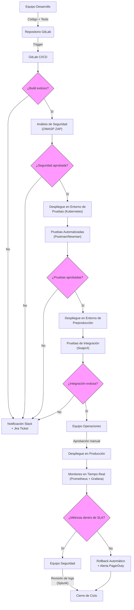
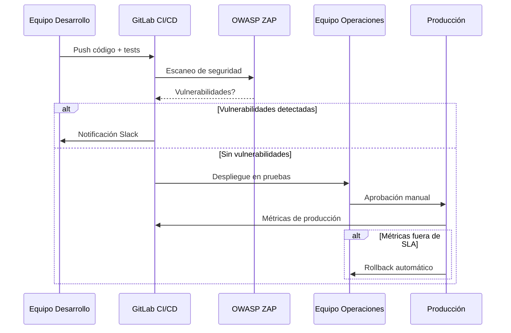

# Flujo de Integración Continuo - BPMN



## Descripción Detallada del Flujo

### **1. Desarrollo (Equipo Desarrollo)**
- **Responsabilidades**:
  - Implementar cambios en el código siguiendo los contratos definidos en `openapi.yaml` y `mapeo-de-datos.csv`.
  - Asegurar que cada cambio incluya pruebas unitarias y de integración.
  - Documentar las dependencias entre equipos en `documentacion/mapa-interacciones.md`.

- **Herramientas**:
  - GitLab (repositorio y merge requests).
  - IDE con plugins de OpenAPI (para validación de contratos).
  - Postman (pruebas manuales de endpoints).

- **Puntos de Decisión**:
  - **Build exitoso**: Validado por GitLab CI/CD. Si falla, se notifica al equipo vía Slack y se crea un ticket en Jira.
  - **Seguridad**: OWASP ZAP analiza vulnerabilidades en el código y dependencias. Si se detectan riesgos altos, el flujo se detiene.

### **2. Operaciones (Equipo Operaciones)**
- **Responsabilidades**:
  - Gestionar los entornos de pruebas, preproducción y producción.
  - Validar que el despliegue cumple con los requisitos de infraestructura (ej. Kubernetes, Helm charts).
  - Monitorear métricas de rendimiento (latencia, throughput) con Prometheus y Grafana.

- **Herramientas**:
  - Kubernetes (orquestación de contenedores).
  - ArgoCD (despliegues GitOps).
  - Grafana (visualización de métricas).

- **Puntos de Decisión**:
  - **Pruebas automatizadas**: Ejecutadas con Postman/Newman. Si fallan, se notifica al equipo de desarrollo.
  - **Integración**: Validada con SoapUI para escenarios complejos (ej. transacciones financieras).
  - **Aprobación manual**: Requerida para despliegues en producción. El equipo de operaciones verifica que las métricas de preproducción cumplen con el SLA (99.9% de disponibilidad).

### **3. Seguridad (Equipo Seguridad)**
- **Responsabilidades**:
  - Revisar logs y alertas generadas por herramientas como Splunk.
  - Validar que el despliegue cumple con estándares financieros (ISO 20022, FAPI) y DevOps (SLSA, OWASP).
  - Documentar riesgos y mitigaciones en `documentacion/analisis-riesgo.md`.

- **Herramientas**:
  - OWASP ZAP (análisis de vulnerabilidades).
  - Splunk (análisis de logs).
  - PagerDuty (alertas críticas).

- **Puntos de Decisión**:
  - **Métricas SLA**: Si las métricas de producción (ej. latencia > 500ms) violan el SLA, se activa un rollback automático.
  - **Revisión de logs**: Se verifica que no haya fugas de datos o accesos no autorizados.

### **4. Herramientas Transversales**
| Herramienta          | Propósito                                                                 | Etapa del Flujo               |
|-----------------------|--------------------------------------------------------------------------|-------------------------------|
| GitLab CI/CD         | Automatizar builds, pruebas y despliegues.                              | Build → Despliegue            |
| OWASP ZAP            | Escaneo de vulnerabilidades en código y dependencias.                   | Build                          |
| Prometheus + Grafana | Monitoreo en tiempo real de métricas de rendimiento y disponibilidad.   | Producción                    |
| Splunk               | Análisis de logs para detección de anomalías.                            | Producción                    |
| PagerDuty            | Alertas para incidentes críticos (ej. caída de servicio).               | Producción                    |
| Jira                 | Gestión de tickets para seguimiento de incidencias.                      | Todas                         |
| Slack                | Notificaciones en tiempo real a los equipos.                             | Todas                         |

### **5. Extensiones OpenAPI para DevOps (`x-devops`)**
El contrato `openapi.yaml` incluye extensiones personalizadas para documentar el flujo CI/CD:

```yaml
x-devops:
  pipelines:
    - name: build
      stages:
        - name: compile
          tools: ["Maven 3.8.6"]
        - name: unit-tests
          tools: ["JUnit 5"]
        - name: integration-tests
          tools: ["Postman", "Newman"]
    - name: deploy
      stages:
        - name: staging
          environment: "kubernetes-staging"
          approval: manual
        - name: production
          environment: "kubernetes-production"
          approval: manual
          metrics:
            - name: latency
              threshold: 500ms
            - name: availability
              threshold: 99.9%
```

### **6. Escenarios de Fallo y Mitigación**
| Escenario                                      | Impacto                          | Mitigación                                                                 |
|-----------------------------------------------|----------------------------------|----------------------------------------------------------------------------|
| Fallo en el build                             | Bloqueo del flujo                | Notificación automática + ticket Jira.                                   |
| Vulnerabilidades críticas detectadas por ZAP  | Riesgo de seguridad              | Detener el flujo y requerir revisión manual.                              |
| Pruebas de integración fallidas               | Inconsistencia en datos          | Rollback a la versión anterior y análisis de root cause.                  |
| Métricas de producción fuera de SLA           | Incumplimiento de contrato       | Rollback automático + alerta PagerDuty.                                  |
| Fallo en el despliegue (Kubernetes)           | Downtime                         | Usar ArgoCD para revertir a la última versión estable.                    |

### **7. Métricas Clave para Observabilidad**
| Métrica                     | Herramienta      | Umbral          | Acción si se Viola                     |
|----------------------------|------------------|------------------|-----------------------------------------|
| Latencia (P99)             | Prometheus       | < 500ms          | Rollback automático.                    |
| Throughput                 | Prometheus       | > 10,000 TPS     | Escalar pods en Kubernetes.             |
| Error Rate                 | Prometheus       | < 0.1%           | Investigar root cause.                  |
| Disponibilidad             | Grafana          | > 99.9%          | Activar alerta crítica.                 |
| Tiempo de despliegue       | GitLab CI/CD     | < 15 min         | Optimizar pipelines.                    |

### **8. Roles y Responsabilidades**
| Equipo            | Responsabilidades                                                                 | Herramientas Clave                     |
|-------------------|-------------------------------------------------------------------------------|-----------------------------------------|
| Desarrollo        | Implementar código, escribir tests, documentar dependencias.               | GitLab, Postman, OpenAPI Generator      |
| Operaciones       | Gestionar entornos, monitorear métricas, aprobar despliegues.              | Kubernetes, Grafana, ArgoCD            |
| Seguridad         | Revisar vulnerabilidades, analizar logs, validar cumplimiento de estándares.| OWASP ZAP, Splunk, PagerDuty            |

### **9. Ejemplo de Notificación en Slack**
```
🚨 *Alerta de Pipeline*

**Proyecto**: Integración Bancaria
**Etapa**: Build
**Estado**: ❌ Fallido
**Razón**: Pruebas unitarias fallidas (JUnit)
**Commit**: `a1b2c3d`
**Autor**: @desarrollador
**Acción**: Revisar ticket [JIRA-1234](https://jira.ejemplo.com/browse/JIRA-1234)
```

### **10. Validación del Flujo**
- **Criterios de Aceptación**: Definidos en `pruebas/criterios-aceptacion.feature` (ejemplo):
  ```gherkin
  Feature: Validación del flujo de integración continuo
    Scenario: Despliegue exitoso en producción
      Given que el código pasa todas las pruebas unitarias e integración
      And que OWASP ZAP no detecta vulnerabilidades críticas
      When el equipo de operaciones aprueba el despliegue
      Then el sistema se despliega en producción
      And las métricas de Prometheus cumplen con el SLA
      
    Scenario: Rollback automático por violación de SLA
      Given que el sistema está en producción
      And la latencia supera 500ms
      When Prometheus detecta la violación
      Then se activa el rollback automático
      And se envía una alerta a PagerDuty
  ```

### **11. Lecciones Aprendidas**
Documentadas en `documentacion/lecciones-aprendidas.md`:
- **Comunicación entre equipos**: La falta de sincronización entre desarrollo y operaciones retrasó despliegues en un 30%. Solución: reuniones diarias de 15 minutos.
- **Automatización de pruebas**: Las pruebas manuales introdujeron errores humanos. Solución: migrar a Postman/Newman.
- **Monitoreo proactivo**: Las métricas de latencia no se revisaban hasta que había quejas de usuarios. Solución: dashboards en Grafana con umbrales automáticos.

### **12. Riesgos y Mitigaciones**
Detallados en `documentacion/analisis-riesgo.md`:
- **Riesgo**: Fallo en el despliegue por configuración incorrecta de Kubernetes.
  - **Mitigación**: Usar Helm charts versionados y validación automática con `kubeval`.
- **Riesgo**: Vulnerabilidades en dependencias de terceros.
  - **Mitigación**: Escaneo automático con OWASP Dependency-Check en cada build.
- **Riesgo**: Incumplimiento de estándares financieros (ISO 20022).
  - **Mitigación**: Validación del contrato OpenAPI contra esquemas ISO 20022 antes de cada despliegue.

### **13. Diagrama de Secuencia (Opcional)**
