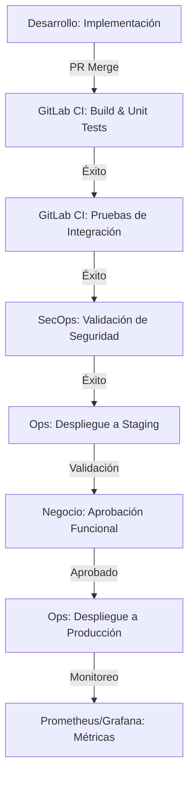

# Mapa de Interacciones y Dependencias del Sistema

## Contexto General
El sistema actual gestiona integraciones financieras entre múltiples equipos distribuidos, con un volumen de **10,000 transacciones por segundo** y un **SLA del 99.9%**. La trazabilidad de las integraciones debe garantizarse por **5 años**, lo que requiere un flujo de trabajo coordinado entre equipos de desarrollo, operaciones y seguridad.

## Equipos Involucrados y Responsabilidades
| Equipo               | Rol Principal                                                                 | Responsabilidades Clave                                                                                     | Herramientas Utilizadas                          |
|----------------------|-------------------------------------------------------------------------------|-------------------------------------------------------------------------------------------------------------|-----------------------------------------------|
| **Desarrollo (Dev)** | Implementación de servicios y contratos de integración                       | - Diseño y mantenimiento de APIs (OpenAPI 3.1)
- Mapeo de datos entre sistemas
- Validación de criterios de aceptación
- Pruebas unitarias y de integración | GitLab, OpenAPI Generator, Postman          |
| **Operaciones (Ops)**| Despliegue, monitoreo y escalabilidad                                      | - Configuración de pipelines CI/CD
- Monitoreo de métricas (Prometheus/Grafana)
- Gestión de infraestructura
- Asegurar cumplimiento de SLA          | GitLab CI/CD, Prometheus, Grafana, Kubernetes |
| **Seguridad (SecOps)**| Cumplimiento de estándares y protección de datos                           | - Validación de seguridad (OWASP ZAP)
- Configuración de tokens y autenticación
- Asegurar trazabilidad y no repudio
- Análisis de riesgos                | OWASP ZAP, Vault, ISO 20022, FAPI            |
| **Negocio**          | Definición de requisitos y validación funcional                             | - Priorización de features
- Validación de flujos de negocio (BPMN)
- Aprobación de criterios de aceptación
- Coordinación entre equipos          | JIRA, Confluence, BPMN.js                   |

## Interacciones Actuales

### Flujo de Desarrollo a Producción

### Dependencias Críticas
1. **Contratos de Integración** (`openapi.yaml`)
   - **Dependencia**: Equipo Dev → Equipo SecOps → Equipo Ops
   - **Restricción**: Cualquier cambio en el contrato requiere validación de seguridad y actualización de mapeos de datos.
   - **Riesgo**: Desincronización entre equipos puede generar fallos en producción.

2. **Mapeo de Datos** (`mapeo-de-datos.csv`)
   - **Dependencia**: Equipo Dev → Equipo Negocio
   - **Restricción**: Los campos obligatorios y reglas de transformación deben alinearse con estándares ISO 20022.
   - **Riesgo**: Datos mal mapeados pueden causar inconsistencias en reportes regulatorios.

3. **Pipeline CI/CD** (`GitLab CI/CD`)
   - **Dependencia**: Equipo Ops → Equipo Dev → Equipo SecOps
   - **Restricción**: Las etapas de seguridad (OWASP ZAP) no pueden omitirse.
   - **Riesgo**: Vulnerabilidades no detectadas pueden exponer datos sensibles.

4. **Monitoreo y Observabilidad** (`Prometheus + Grafana`)
   - **Dependencia**: Equipo Ops → Equipo Dev
   - **Restricción**: Las métricas deben incluir latencia, tasa de errores y throughput.
   - **Riesgo**: Falta de visibilidad puede retrasar la detección de fallos.

## Restricciones Identificadas
| Área                | Restricción                                                                 | Impacto                                                                                     | Mitigación Propuesta                          |
|---------------------|-----------------------------------------------------------------------------|---------------------------------------------------------------------------------------------|---------------------------------------------|
| **Contratos**       | Cambios en OpenAPI requieren aprobación de SecOps                          | Retrasos en despliegues                                                                    | Automatizar validación con Redocly CLI      |
| **Seguridad**       | Validación manual de vulnerabilidades con OWASP ZAP                        | Cuellos de botella en el pipeline                                                          | Integrar escaneo automático en CI/CD        |
| **Despliegue**      | Dependencia de aprobación manual para producción                           | Incumplimiento de SLA en despliegues urgentes                                             | Implementar canary releases con rollback    |
| **Trazabilidad**    | Logs dispersos en múltiples sistemas                                       | Dificultad para auditar integridad de datos                                                 | Centralizar logs con ELK Stack              |

## Ambigüedades y Riesgos
1. **Falta de definición clara de SLAs por equipo**
   - **Problema**: Los equipos Dev y Ops no tienen métricas alineadas para medir el éxito del despliegue.
   - **Impacto**: Dificultad para escalar el sistema bajo carga.
   - **Acción**: Definir SLAs por etapa (ej. "Tiempo máximo de despliegue: 15 minutos").

2. **Inconsistencia en versiones de dependencias**
   - **Problema**: Equipos usan diferentes versiones de OpenAPI Generator y Redocly CLI.
   - **Impacto**: Fallos en generación de clientes y validación de contratos.
   - **Acción**: Establecer un archivo `.tool-versions` en el repositorio.

3. **Falta de pruebas de carga en staging**
   - **Problema**: El entorno de staging no replica las condiciones de producción (10k TPS).
   - **Impacto**: Fallos no detectados hasta producción.
   - **Acción**: Implementar pruebas de carga con Gatling o Locust.

4. **Gobernanza de tokens de seguridad**
   - **Problema**: Los tokens de autenticación se gestionan manualmente en archivos locales.
   - **Impacto**: Riesgo de filtración de credenciales.
   - **Acción**: Migrar a Vault con rotación automática.

## Métricas Actuales (Baseline)
| Métrica                     | Valor Actual | Objetivo (SLA) | Brecha                     |
|----------------------------|--------------|----------------|----------------------------|
| Tiempo promedio de despliegue | 45 minutos   | <15 minutos    | -30 minutos                |
| Tasa de errores en producción | 0.5%         | <0.1%          | +0.4%                      |
| Cobertura de pruebas        | 75%          | 90%            | +15%                       |
| Tiempo de detección de fallos | 10 minutos   | <2 minutos     | -8 minutos                 |
| Cumplimiento de SLA         | 99.7%        | 99.9%          | -0.2%                      |

## Recomendaciones Iniciales
1. **Automatizar validación de contratos**
   - Integrar `redocly lint` en el pipeline para validar OpenAPI antes del merge.
   - Ejemplo de regla: `paths-required: error` (todos los paths deben estar documentados).

2. **Implementar despliegues canary**
   - Reducir riesgo de despliegues en producción mediante rollouts graduales.
   - Herramienta recomendada: Kubernetes con Istio.

3. **Centralizar logs y métricas**
   - Unificar logs de todos los equipos en un stack ELK.
   - Métricas clave: latencia, throughput, errores HTTP.

4. **Establecer reuniones de sincronización semanales**
   - Objetivo: Alinear prioridades entre Dev, Ops y SecOps.
   - Agenda: Revisión de métricas, bloqueos y riesgos.

---
*Nota: Este documento es la base para la Fase 2 (Diseño del flujo CI/CD).*