# Propuesta de Flujo de Integración Continuo

## Objetivos del Flujo
1. **Reducir tiempo de despliegue** de 45 minutos a <15 minutos.
2. **Aumentar cobertura de pruebas** del 75% al 90%.
3. **Garantizar trazabilidad** de todas las integraciones con logs centralizados.
4. **Automatizar validaciones de seguridad** para cumplir con estándares FAPI e ISO 20022.
5. **Mejorar colaboración** entre equipos Dev, Ops y SecOps mediante etapas claras y métricas compartidas.

## Arquitectura del Flujo

```mermaid
flowchart LR
    A[Commit/PR] -->|Trigger| B[Build & Unit Tests]
    B -->|Éxito| C[Pruebas de Integración]
    C -->|Éxito| D[Validación de Seguridad]
    D -->|Éxito| E[Despliegue a Staging]
    E -->|Validación| F[Pruebas de Carga]
    F -->|Éxito| G[Despliegue Canary]
    G -->|Monitoreo| H[Despliegue a Producción]
    H -->|Métricas| I[Prometheus/Grafana]
    I -->|Alertas| J[Rollback Automático si SLA Violado]
```


## Etapas del Pipeline

### 1. Desarrollo (Dev)
**Herramientas**: GitLab CI/CD, OpenAPI Generator, Postman
**Responsables**: Equipo Dev
**Tareas**:
- Implementación de features en ramas feature/*
- Validación local con `redocly lint openapi.yaml`
- Pruebas unitarias con cobertura mínima del 90%
- Creación de PR con revisión por pares

**Ejemplo de validación OpenAPI en CI**:
```yaml
# .gitlab-ci.yml
validate_openapi:
  stage: build
  script:
    - npx @redocly/cli lint openapi.yaml
    - openapi-generator validate -i openapi.yaml
```

### 2. Build y Pruebas Unitarias
**Herramientas**: GitLab CI/CD, Jest/Unit Testing Framework
**Responsables**: Equipo Dev
**Métricas**:
- Tiempo de build: <5 minutos
- Cobertura de pruebas: >90%
- Fallos bloqueantes: 0

**Ejemplo de etapa en GitLab CI**:
```yaml
build:
  stage: build
  script:
    - npm install
    - npm run build
    - npm run test:coverage
  artifacts:
    reports:
      cobertura: coverage/cobertura-coverage.xml
```

### 3. Pruebas de Integración
**Herramientas**: GitLab CI/CD, Postman/Newman, BPMN.js
**Responsables**: Equipo Dev + Equipo Negocio
**Tareas**:
- Ejecución de escenarios Gherkin (`pruebas/criterios-aceptacion.feature`)
- Validación de mapeos de datos (`contratos/mapeo-datos.csv`)
- Pruebas de contrato con ejemplos concretos

**Ejemplo de escenario Gherkin**:
```gherkin
Feature: Validación de mapeo de datos
  Scenario: Mapeo de fecha incorrecto
    Given un registro con fecha "31/02/2023"
    When se mapea al formato ISO 8601
    Then debe retornar error "Fecha inválida"
```

### 4. Validación de Seguridad
**Herramientas**: OWASP ZAP, GitLab CI/CD
**Responsables**: Equipo SecOps
**Tareas**:
- Escaneo de vulnerabilidades en APIs (OWASP Top 10)
- Validación de tokens (`seguridad/token-utils.md`)
- Revisión de configuración de seguridad (`seguridad/security-config.md`)
- Cumplimiento de estándares FAPI e ISO 20022

**Ejemplo de configuración OWASP ZAP**:
```yaml
zap_scan:
  stage: security
  script:
    - zap-baseline.py -t https://staging.example.com -r report.html
    - if [ $(grep -c "High Risk" report.html) -gt 0 ]; then exit 1; fi
  artifacts:
    paths:
      - report.html
```

### 5. Despliegue a Staging
**Herramientas**: GitLab CI/CD, Kubernetes
**Responsables**: Equipo Ops
**Tareas**:
- Despliegue automático a entorno de staging
- Validación de configuración (`config/staging.yaml`)
- Pruebas de humo (smoke tests)

**Ejemplo de despliegue**:
```yaml
deploy_staging:
  stage: deploy
  script:
    - kubectl apply -f k8s/staging.yaml
    - kubectl rollout status deployment/api-deployment
    - curl -I https://staging.example.com/health
```

### 6. Pruebas de Carga
**Herramientas**: Gatling, Prometheus
**Responsables**: Equipo Ops
**Métricas**:
- Throughput: >10,000 TPS
- Latencia: <100ms p99
- Errores: <0.1%

**Ejemplo de prueba Gatling**:
```scala
class LoadTestSimulation extends Simulation {
  val httpProtocol = http.baseUrl("https://staging.example.com")
  val scenario = scenario("API Load Test")
    .exec(http("Get Transactions")
      .get("/transactions")
      .check(status.is(200)))

  setUp(scenario.inject(rampUsers(10000).during(60.seconds)))
    .protocols(httpProtocol)
    .assertions(
      global.responseTime.max.lt(500),
      global.successfulRequests.percent.gt(99.9)
    )
}
```

### 7. Despliegue Canary
**Herramientas**: Kubernetes, Istio
**Responsables**: Equipo Ops
**Estrategia**:
- Despliegue del 10% del tráfico a la nueva versión
- Monitoreo de métricas durante 15 minutos
- Rollback automático si se violan SLAs

**Ejemplo de configuración Istio**:
```yaml
apiVersion: networking.istio.io/v1alpha3
kind: VirtualService
metadata:
  name: api-service
spec:
  hosts:
    - api.example.com
  http:
    - route:
        - destination:
            host: api-v1
          weight: 90
        - destination:
            host: api-v2
          weight: 10
```

### 8. Despliegue a Producción
**Herramientas**: GitLab CI/CD, Kubernetes
**Responsables**: Equipo Ops
**Tareas**:
- Despliegue completo a producción
- Validación de salud del servicio
- Actualización de documentación (`README.md`)

### 9. Monitoreo y Observabilidad
**Herramientas**: Prometheus, Grafana, ELK Stack
**Responsables**: Equipo Ops
**Métricas Clave**:
- Latencia (p50, p90, p99)
- Throughput (TPS)
- Errores HTTP (4xx, 5xx)
- Saturación de recursos (CPU, memoria)
- Tiempo de despliegue

**Ejemplo de dashboard Grafana**:
```json
{
  "dashboard": {
    "title": "API Performance",
    "panels": [
      {
        "title": "Latencia (p99)",
        "type": "graph",
        "targets": [
          {
            "expr": "histogram_quantile(0.99, sum(rate(http_request_duration_seconds_bucket[5m])) by (le))",
            "legendFormat": "{{route}}"
          }
        ]
      }
    ]
  }
}
```

## Participación de Equipos
| Etapa                     | Dev | Ops | SecOps | Negocio |
|---------------------------|-----|-----|--------|---------|
| Desarrollo                | ✅  |     |        |         |
| Build y Pruebas Unitarias | ✅  |     |        |         |
| Pruebas de Integración    | ✅  |     |        | ✅      |
| Validación de Seguridad   |     |     | ✅     |         |
| Despliegue a Staging      |     | ✅  |        |         |
| Pruebas de Carga          |     | ✅  |        |         |
| Despliegue Canary         |     | ✅  |        |         |
| Despliegue a Producción   |     | ✅  |        |         |
| Monitoreo                 | ✅  | ✅  | ✅     | ✅      |

## Herramientas Recomendadas
| Herramienta          | Propósito                                                                 | Equipo Responsable |
|----------------------|--------------------------------------------------------------------------|--------------------|
| GitLab CI/CD         | Orquestación del pipeline                                                 | Ops                 |
| OpenAPI Generator    | Generación de clientes a partir de contratos                             | Dev                 |
| Redocly CLI          | Validación de contratos OpenAPI                                           | Dev                 |
| OWASP ZAP            | Escaneo de vulnerabilidades                                               | SecOps              |
| Prometheus + Grafana | Monitoreo de métricas                                                     | Ops                 |
| Kubernetes           | Orquestación de contenedores                                              | Ops                 |
| Istio                | Gestión de tráfico para despliegues canary                               | Ops                 |
| Gatling              | Pruebas de carga                                                          | Ops                 |
| ELK Stack            | Centralización de logs                                                     | Ops                 |
| Vault                | Gestión de secretos                                                       | SecOps              |

## Métricas de Éxito
| Métrica                     | Valor Inicial | Valor Objetivo | Herramienta de Medición |
|----------------------------|---------------|----------------|--------------------------|
| Tiempo de despliegue       | 45 minutos    | <15 minutos    | GitLab CI/CD             |
| Cobertura de pruebas       | 75%           | 90%            | Jest/Cobertura           |
| Tasa de errores en prod    | 0.5%          | <0.1%          | Prometheus/Grafana       |
| Throughput                 | 8,000 TPS     | >10,000 TPS    | Gatling                  |
| Tiempo de detección de fallos | 10 minutos  | <2 minutos     | Grafana Alerts          |
| Cumplimiento de SLA        | 99.7%         | 99.9%          | Prometheus               |

## Riesgos y Mitigaciones
| Riesgo                                 | Impacto                                  | Mitigación                                                                 |
|----------------------------------------|------------------------------------------|-----------------------------------------------------------------------------|
| Fallos en validación OpenAPI           | Despliegues bloqueados                   | Automatizar validación con Redocly CLI en PRs                              |
| Vulnerabilidades no detectadas         | Exposición de datos sensibles           | Integrar OWASP ZAP en el pipeline                                          |
| Desincronización entre equipos         | Retrasos en despliegues                 | Reuniones semanales de sincronización con métricas compartidas             |
| Pruebas de carga insuficientes         | Fallos en producción bajo carga         | Implementar Gatling con escenarios realistas                              |
| Falta de trazabilidad                  | Dificultad para auditar                  | Centralizar logs con ELK Stack                                             |

## Extensiones OpenAPI para DevOps
Para documentar el pipeline en el contrato OpenAPI, se proponen las siguientes extensiones (`x-devops`):

```yaml
# openapi.yaml
paths:
  /transactions:
    get:
      x-devops:
        pipeline:
          stages:
            - build
            - test
            - security
            - staging
            - load-test
            - canary
            - production
        metrics:
          - name: latency
            target: <100ms
          - name: errors
            target: <0.1%
          - name: throughput
            target: >10000 TPS
        participants:
          - Dev
          - Ops
          - SecOps
```

## Cronograma de Implementación
| Fase          | Duración | Responsables       | Entregables                          |
|---------------|----------|--------------------|--------------------------------------|
| Preparación   | 2 semanas| Dev + Ops          | Definición de SLAs y herramientas    |
| Implementación| 4 semanas| Dev + Ops + SecOps | Pipeline funcional en staging        |
| Validación    | 2 semanas| Todos              | Métricas de éxito alcanzadas         |
| Rollout       | 1 semana | Ops                | Despliegue a producción              |

---
*Nota: Este documento es la base para la Fase 3 (Implementación y validación).*