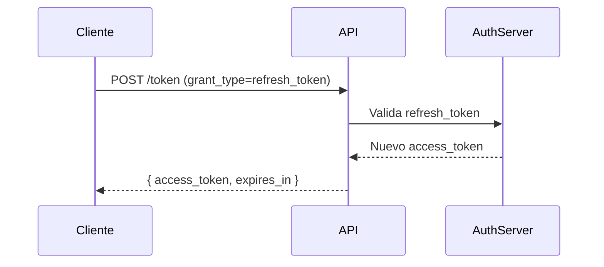

# Utilidades para Manejo de Tokens

## 1. Generación de Tokens

### 1.1. Script para Generar Tokens JWT (Node.js)
```javascript
const jwt = require('jsonwebtoken');
const { createPrivateKey } = require('crypto');

const privateKey = createPrivateKey({
  key: Buffer.from(process.env.PRIVATE_KEY, 'base64'),
  format: 'der',
  type: 'pkcs8'
});

function generateToken(userId, scopes) {
  return jwt.sign({
    sub: userId,
    scope: scopes.join(' '),
    iss: 'https://auth.banco.com/realms/master',
    aud: 'integracion-api',
    iat: Math.floor(Date.now() / 1000),
    exp: Math.floor(Date.now() / 1000) + 3600
  }, privateKey, { algorithm: 'RS256' });
}

module.exports = { generateToken };
```

### 1.2. Ejemplo de Payload JWT
```json
{
  "sub": "1234567890",
  "scope": "openid profile payments",
  "iss": "https://auth.banco.com/realms/master",
  "aud": "integracion-api",
  "iat": 1712345678,
  "exp": 1712349278,
  "jti": "abcdef1234567890"
}
```

## 2. Validación de Tokens

### 2.1. Middleware para Validación (Express.js)
```javascript
const jwt = require('jsonwebtoken');
const { createPublicKey } = require('crypto');

const publicKey = createPublicKey({
  key: Buffer.from(process.env.PUBLIC_KEY, 'base64'),
  format: 'der',
  type: 'spki'
});

function validateToken(req, res, next) {
  const authHeader = req.headers['authorization'];
  const token = authHeader && authHeader.split(' ')[1];

  if (!token) return res.sendStatus(401);

  jwt.verify(token, publicKey, { algorithms: ['RS256'] }, (err, user) => {
    if (err) return res.sendStatus(403);
    req.user = user;
    next();
  });
}

module.exports = validateToken;
```

### 2.2. Validación en Python
```python
import jwt
from cryptography.hazmat.backends import default_backend
from cryptography.hazmat.primitives import serialization

public_key = serialization.load_der_public_key(
    base64.b64decode(os.getenv('PUBLIC_KEY')),
    backend=default_backend()
)

def validate_token(token):
    try:
        return jwt.decode(
            token,
            public_key,
            algorithms=['RS256'],
            audience='integracion-api',
            issuer='https://auth.banco.com/realms/master'
        )
    except jwt.ExpiredSignatureError:
        raise Exception("Token expirado")
    except jwt.InvalidTokenError:
        raise Exception("Token inválido")
```

## 3. Renovación de Tokens

### 3.1. Flujo de Renovación con Refresh Tokens


### 3.2. Script para Renovación
```bash
#!/bin/bash

REFRESH_TOKEN="$1"
CLIENT_ID="integracion-api"
CLIENT_SECRET="$2"

curl -X POST "https://auth.banco.com/realms/master/protocol/openid-connect/token" \
     -H "Content-Type: application/x-www-form-urlencoded" \
     -d "grant_type=refresh_token" \
     -d "client_id=$CLIENT_ID" \
     -d "client_secret=$CLIENT_SECRET" \
     -d "refresh_token=$REFRESH_TOKEN"
```

## 4. Integración con DevOps

### 4.1. GitLab CI para Gestión de Tokens
```yaml
# .gitlab-ci.yml
variables:
  OAUTH_CLIENT_ID: $OAUTH_CLIENT_ID
  OAUTH_CLIENT_SECRET: $OAUTH_CLIENT_SECRET

stages:
  - test
  - deploy

generate_token:
  stage: test
  image: node:18
  script:
    - npm install jsonwebtoken
    - node -e "console.log(require('./token-utils.js').generateToken('ci-pipeline', ['deploy']))" > token.txt
  artifacts:
    paths:
      - token.txt

deploy:
  stage: deploy
  image: curlimages/curl
  script:
    - TOKEN=$(cat token.txt)
    - curl -H "Authorization: Bearer $TOKEN" https://integracion-api.banco.com/deploy
```

### 4.2. Jenkins Pipeline
```groovy
pipeline {
    agent any
    environment {
        OAUTH_CLIENT_ID = credentials('oauth-client-id')
        OAUTH_CLIENT_SECRET = credentials('oauth-client-secret')
    }
    stages {
        stage('Generate Token') {
            steps {
                script {
                    def token = sh(script: "node token-utils.js generateToken 'jenkins-pipeline' ['deploy']", returnStdout: true).trim()
                    env.TOKEN = token
                }
            }
        }
        stage('Deploy') {
            steps {
                sh "curl -H 'Authorization: Bearer ${env.TOKEN}' https://integracion-api.banco.com/deploy"
            }
        }
    }
}
```

## 5. Buenas Prácticas

### 5.1. Seguridad en Tokens
- **Almacenamiento**: Nunca almacenar tokens en código o repositorios
- **Transmisión**: Usar siempre HTTPS
- **Expiración**: Tokens de corta duración (máximo 1 hora)
- **Refresh Tokens**: Usar solo en backends, no en clientes
- **Alcance**: Seguir el principio de mínimo privilegio

### 5.2. Monitoreo y Auditoría
- Registrar todos los intentos de autenticación (exitosos y fallidos)
- Monitorear la tasa de renovación de tokens
- Alertar sobre patrones inusuales (ej. mismo token usado desde múltiples IPs)

### 5.3. Integración con SLSA
- Firmar los tokens con claves específicas para el pipeline
- Registrar la generación de tokens en el sistema de trazabilidad
- Validar la firma de los tokens en cada etapa del pipeline

## 6. Ejemplo de Integración con OpenAPI

### 6.1. Extensión para Documentación
```yaml
# openapi.yaml
components:
  securitySchemes:
    oauth:
      type: oauth2
      flows:
        authorizationCode:
          authorizationUrl: https://auth.banco.com/realms/master/protocol/openid-connect/auth
          tokenUrl: https://auth.banco.com/realms/master/protocol/openid-connect/token
          scopes:
            openid: Autenticación OpenID
            profile: Perfil de usuario
            payments: Operaciones de pago
      x-token-utils:
        generationScript: scripts/generate-token.js
        validationScript: scripts/validate-token.js
        renewalEndpoint: /token/renew
```

## 7. Superficie de Práctica

### 7.1. Tareas Pendientes
- [ ] Implementar rotación automática de refresh tokens cada 30 días
- [ ] Crear script para revocación masiva de tokens en caso de incidente
- [ ] Configurar alertas para tokens usados después de su expiración
- [ ] Documentar procedimiento para manejo de tokens en entornos híbridos (cloud/on-premise)

### 7.2. Preguntas para Reflexión
- ¿Cómo manejarías la revocación de tokens en un entorno distribuido?
- ¿Qué estrategias usarías para proteger los refresh tokens en sistemas legacy?
- ¿Cómo garantizarías la no repudiación en las operaciones realizadas con estos tokens?
- ¿Qué métricas de seguridad implementarías para monitorear el uso de tokens?